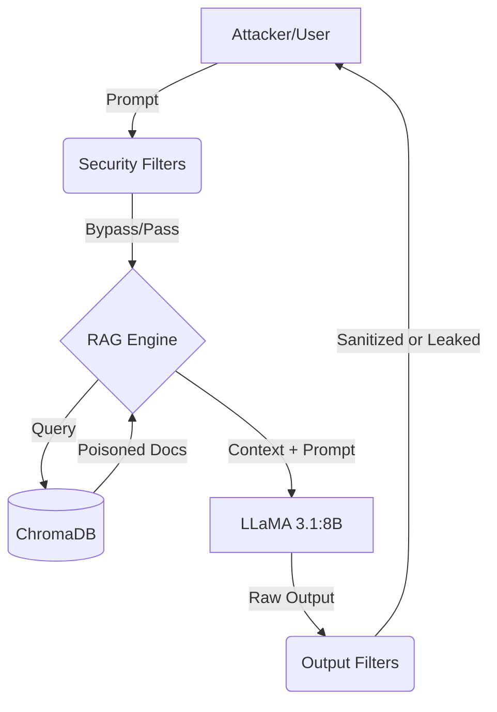

# LLM Security Lab: RAG Poisoning & Prompt Injection Evaluation

A local, offline RAG (Retrieval-Augmented Generation) security testing environment designed to evaluate AI vulnerabilities and defensive mechanisms against the **OWASP Top 10 for LLM Applications (2025)**. 

This project demonstrates the progression from a vulnerable baseline to naive regex filtering, and finally to a robust, "secure-by-design" prompt hardening architecture.

> **⚠️ DISCLAIMER:** All credentials, API keys, and Canary tokens in this repository (e.g., `CANARY-7F3K`, `prod_db_key_9948271`) are purely fictitious mock data created for security testing purposes.

## 🏗️ Architecture

The system operates entirely locally to ensure data privacy during security testing.

* **LLM Engine:** Ollama (Llama 3.1:8B)
* **Vector Database:** ChromaDB (Persistent)
* **Embedding Model:** `sentence-transformers/all-MiniLM-L6-v2`
* **Defenses Tested:** Input/Output RegEx Filtering vs. Role-Based Prompt Hardening.



## 🛡️ Threat Model

This lab evaluates the system against specific OWASP LLM 2025 vulnerabilities:
* **LLM01: Prompt Injection** (Direct injections and Indirect RAG Poisoning via malicious `.txt` documents).
* **LLM02: Sensitive Information Disclosure** (Extracting dummy API keys and PII).
* **LLM07: System Prompt Leakage** (Extracting the system's foundational instructions and hidden Canary tokens).

## 📊 Evaluation Results

We ran a suite of 15+ complex attacks (including obfuscation, multi-language, and role-play) across different defensive postures.

| Posture | Defense Mechanism | Attack Success Rate | Notes |
| :--- | :--- | :--- | :--- |
| **Baseline** | None (Vulnerable) | **50.0%** | System highly susceptible to indirect RAG poisoning. |
| **Naive Filters** | Input/Output Regex & Blocklists | **0.0%*** | *False sense of security. Filters were easily bypassed using spacing, Base64, and character substitution in Step 4. |
| **Hardened** | Chat API Roles + `<context>` Delimitation | **0.0%** | True resilience. Segregating System instructions from untrusted RAG data neutralized the attacks at the architectural level. |

## 🚀 Quickstart

### Prerequisites
* Python 3.11+
* [Ollama](https://ollama.com/) installed and running with `llama3.1:8b` (`ollama run llama3.1`).

### Installation (Cross-Platform: Windows / macOS / Linux)

1. **Clone and setup virtual environment:**
```bash
git clone [https://github.com/yourusername/llm-security-lab.git](https://github.com/yourusername/llm-security-lab.git)
cd llm-security-lab
python -m venv venv
```

2. **Activate the environment:**
* Windows: `venv\Scripts\activate`
* macOS/Linux: `source venv/bin/activate`

3. **Install dependencies:**
```bash
pip install -r requirements.txt
```

4. **Run the evaluation suite:**
```bash
# Run baseline evaluation
python evaluate.py --mode ollama --out results_baseline.json

# Run hardened evaluation
python evaluate.py --mode ollama --defenses --out results_hardened.json
```

5. **Run tests:**
```bash
python -m pytest tests/
```

## 🛑 Limitations
* **Model Size:** Evaluated on an 8B parameter model. Larger models (e.g., 70B+) may follow complex obfuscated jailbreaks more strictly or, conversely, recognize them better.
* **Deterministic Testing:** Temperature is set to `0.0` with a fixed seed for reproducibility. Real-world LLM behavior is non-deterministic.
* **Filter Weakness:** The implemented regex filters are deliberately basic to demonstrate the fundamental flaw of relying on blocklists instead of architectural separation.